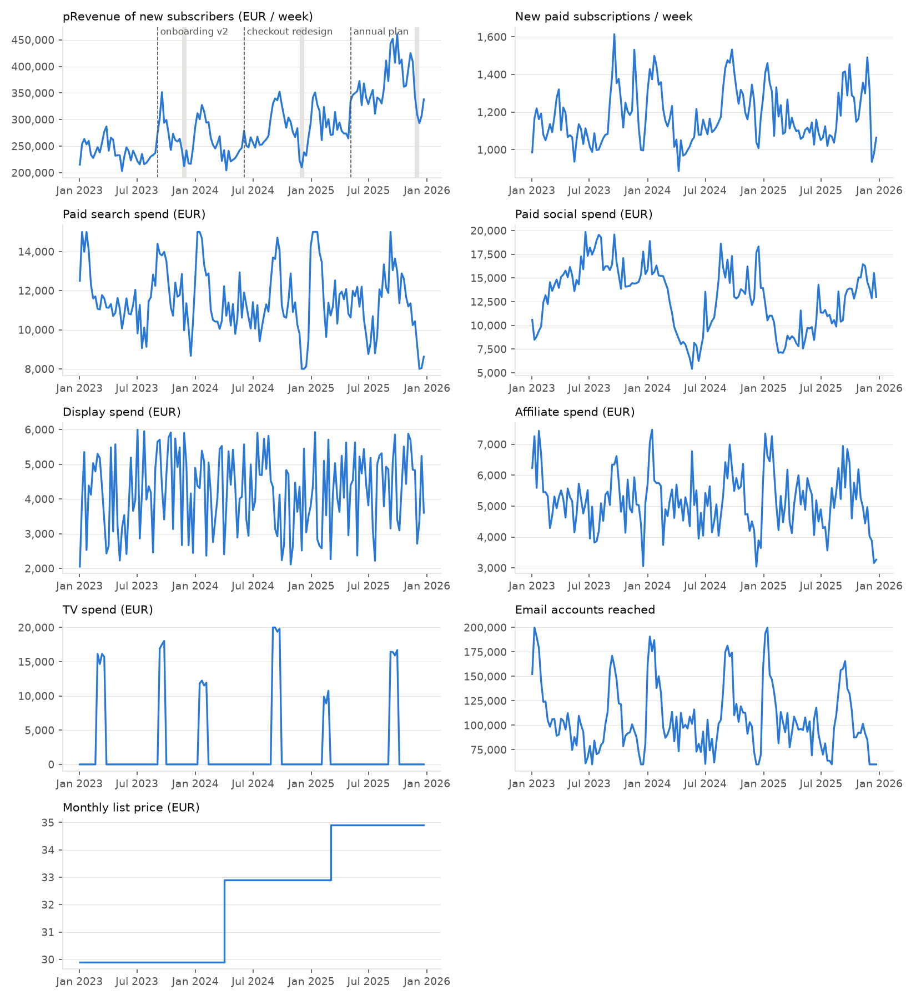
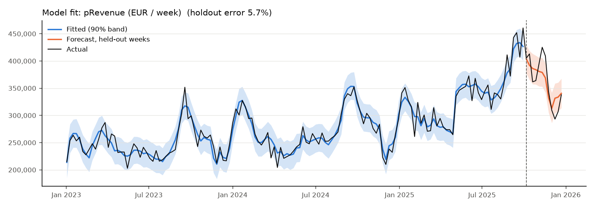
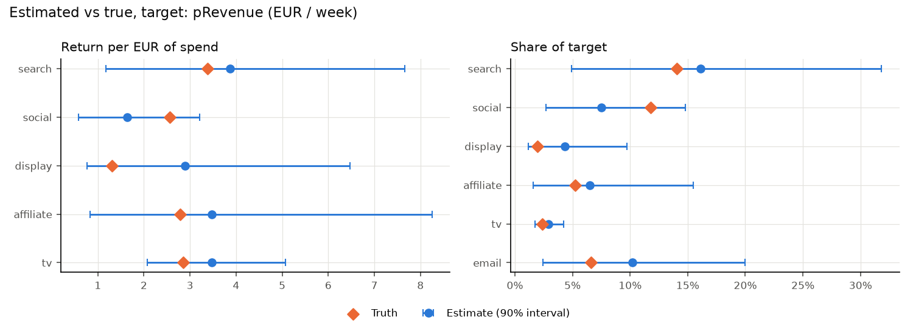
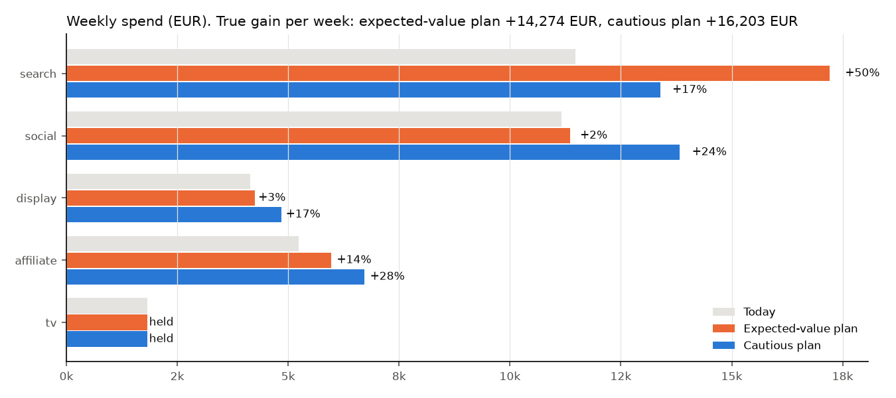
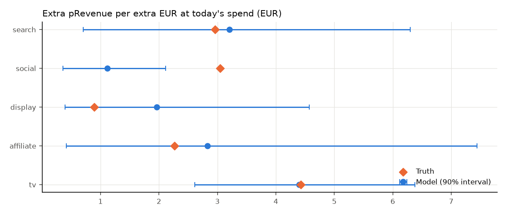

# Bayesian marketing mix model for a subscription business

Which marketing channels drive the predicted revenue of new subscribers, and should next quarter's budget move? This project answers that with a Bayesian marketing mix model (MMM) in PyMC, then checks every answer against a known ground truth.

Built on synthetic data so that the true effect of every channel is known. That makes it possible to show not just what the model says, but where it is right and where it is wrong.

## Key findings

- **The model fits well and recovers the true return of every channel within its 90% interval.** Forecast error on 12 held-out weeks is 5.8%.
- **A budget optimiser that trusts the model's best guess loses money.** It recommends cutting paid social by 50% with an 82% chance of winning. In the true business, that plan loses 5.6% of media-driven pRevenue.
- **The cause is a curve the data cannot pin down.** The model thinks social is close to saturated. In reality it has the most room to grow. Weekly data shows how much a channel returns on average, but not how much the next euro returns.
- **Experiments and caution fix it.** Adding two lift tests to the model and only moving budget where the gain survives the model's uncertainty turns a loss into the right call: hold the current split, and test search next.

## The business

A B2C subscription product sold in Germany, Austria and Switzerland, simulated week by week from January 2023 to December 2025.

| | |
|---|---|
| Subscribers | about 184,000, 900 to 1,600 a week |
| Paid channels | paid search, paid social, display, affiliate, TV (in flights) |
| Owned channel | email, measured as accounts reached |
| Seasonality | peaks in January and September, low point in late December |
| Other drivers | Black Friday promos, three product launches, two price increases |
| Media budget | about €34,000 a week |



Two channels are deliberately hard to measure: display is small, and affiliate spend moves with search spend (84% correlated). Real marketing data has both problems.

## The target: pRevenue

The model explains **pRevenue**: the predicted 24-month revenue of everyone who subscribed that week. Each subscriber's pRevenue comes from a separate prediction model that uses their attributes (plan, country, device, payment method, discount), as a CLV model would in practice.

This rewards channels that bring valuable subscribers, not just many of them, and it is available the week a subscriber joins. It also has risks, which the simulation includes on purpose:

- **The prediction model cannot see the channel.** Affiliate subscribers churn a little faster than their attributes suggest, so their pRevenue is 13% too high, against 4% for search. The MMM inherits that error and has no way to detect it.
- **Prediction models get updated.** Version 2 of the pRevenue model, from January 2025, predicts 5% higher across the board. To the MMM, that looks like a real change in the business.

A second model on new subscriptions runs alongside it, to compare volume with value.

## The model

Weekly pRevenue = baseline + effect of each channel + noise.

- **Baseline:** trend, yearly seasonality, promo weeks, the three product launches, and price.
- **Channel effects:** each channel's spend carries over into later weeks (adstock), then runs into diminishing returns (a Hill saturation curve).
- **Priors on return per euro:** instead of priors on abstract effect sizes, each paid channel starts from "a euro of spend usually returns between €0.6 and €6.3 of pRevenue". That's a belief a marketer can challenge. My first version, with priors on effect size, gave media 57% of the credit against a true 42%.
- **Lift tests (optional):** an experiment result enters the model as an observation of how much pRevenue rises between two spend levels.

Sampling takes about 3 minutes on a 2-core cloud machine.

## Does it work?

All runs converge cleanly: no divergences, all R-hat at or below 1.01.



Error is 3.5% on training weeks and 5.8% on the 12 held-out weeks. The forecast band covers 8 of those 12 weeks. It misses around Black Friday, because the model treats a promo as a fixed bump while its real effect grows with demand.

**Estimated vs true return per euro (pRevenue):**



| Channel | Estimate (90% interval) | Truth | Why it misses |
|---|---|---|---|
| Paid search | 3.8 (1.1 to 7.8) | 3.4 | shares credit with affiliate |
| Paid social | 1.6 (0.6 to 3.2) | 2.6 | slow budget drift looks like trend |
| Display | 2.9 (0.8 to 6.4) | 1.3 | too small to measure; prior pulls it up |
| Affiliate | 3.5 (0.8 to 8.2) | 2.8 | shares credit with search |
| TV | 3.5 (2.1 to 5.1) | 2.8 | flights make it the easiest to measure |

Every truth falls inside its interval, for both targets. Email gets 10% of the credit against a true 7%, because it peaks in the same weeks as seasonal demand.

## From model to budget decision

The optimiser splits a fixed weekly budget across search, social, display and affiliate. TV is held, because it runs in flights rather than at a steady weekly level. No channel may move more than 50% from today's spend, since the model has never seen spend outside that range.

It compares two ways of choosing a plan:

- **Expected value:** maximise the model's best guess of pRevenue.
- **Cautious:** maximise the expected gain minus one standard deviation of it, so a move only happens if it still pays off when the model is somewhat wrong.

The true result of each plan, measured on the true response curves:

| Model | Expected-value plan | Cautious plan |
|---|---|---|
| Without lift tests | loses €6,000 a week | loses €2,900 a week |
| With two lift tests | loses €2,700 a week | holds today's split |
| With two lift tests, budget +20% | gains €14,700 a week | gains €16,400 a week |



Why the expected-value plan fails: it acts on marginal returns, the extra pRevenue from the next euro, and those are what the model knows least about.



The model puts social's marginal return at 1.1 against a true 3.0, because a prior had to fill in the shape of its curve.

The two lift tests are a 50% increase in social and a 50% cut in affiliate. A test that switches a channel off only measures its average return. A test that changes spend near today's level measures what the next euro buys, which is what a budget decision needs. With the tests, affiliate's marginal return becomes accurate (2.1 against 2.3). Search remains overrated, so the cautious optimiser holds the budget rather than gamble. The next experiment should be a search test.

**Volume vs value:** the new-subscriptions model misses in the same places (display overrated, social underrated, though less so), and its cautious plan also holds. Ranking channels by volume or by value gives much the same answer here, because channel barely changes what a subscriber is worth.

## What this means for real MMM work

1. **Use an MMM to rank where to look, and experiments to decide.** Average returns were well recovered; marginal returns were not.
2. **Never optimise on the posterior mean alone.** An 82% chance of winning was wrong here, because the uncertainty itself was understated.
3. **Design lift tests around the decision.** To decide whether to scale a channel, test scaling it.
4. **Watch the target, not just the model.** A pRevenue model that cannot see the channel, or that gets retrained, quietly changes what the MMM is measuring.

## Limitations

- The data is synthetic. The generator was written knowing what the model would assume, although the true process differs from the model's (multiplicative rather than additive effects, with subscriber-level churn).
- The lift-test results in `data/lift_tests.json` are placeholders, set close to the true values. A follow-up project on geo-holdout test design will produce them from a simulated experiment.
- Promo effects are modelled as fixed, and there's no regional breakdown.

## Repository

```
src/mmm/
  simulate.py     subscriber-level data generator, with ground truth
  transforms.py   adstock and saturation
  data.py         scaling and model inputs
  model.py        PyMC model, with ROI priors and lift tests
  optimize.py     response curves, marginal returns, budget optimiser
  truth.py        true response curves, for evaluation only
scripts/
  fit_model.py        fit, check, compare with truth
  optimize_budget.py  plans and their true outcome
  plot_data.py        overview of the simulated data
data/             weekly data, subscriber data, lift tests, truth
artifacts/        charts, tables and saved posteriors from each run
tests/            unit tests
```

## How to run

Open in GitHub Codespaces (the dev container installs everything), or install locally with Python 3.12:

```
pip install -r requirements.txt && pip install -e .
python -m mmm.simulate
python -m pytest -q
python scripts/fit_model.py --target p_revenue
python scripts/fit_model.py --target p_revenue --calibrate
python scripts/optimize_budget.py --target p_revenue --calibrated
```

Exact numbers can vary slightly between machines.

## Notes

Built by Milesh Vadodaria, with AI assistance for code. Modelling choices, checks and conclusions are my own.
